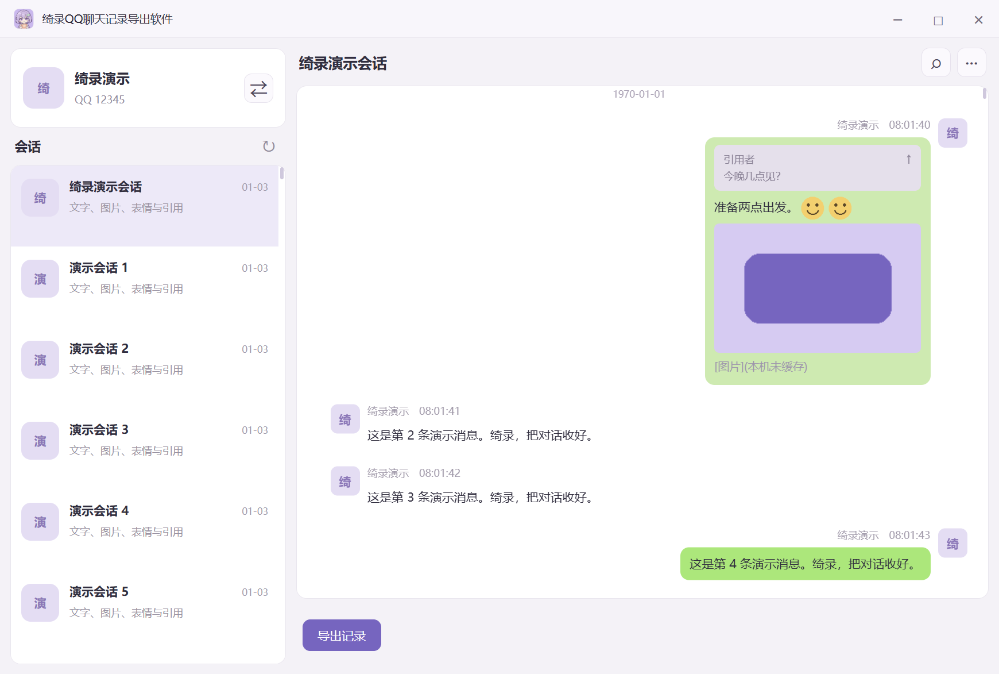

<p align="center"></p>
<h1 align="center">绮录QQ聊天记录导出软件</h1>
<p align="center">把对话，收进绮录。</p>
<p align="center">在自己的电脑上浏览、整理和保存属于自己的 QQ 聊天记录。</p>

<p align="center">
  <a href="https://github.com/qingzhi-star/QL-qq-chat-history-exporter/releases/latest">下载正式版</a> ·
  <a href="#快速开始">快速开始</a> ·
  <a href="#离线使用">离线使用</a> ·
  <a href="https://github.com/qingzhi-star/QL-qq-chat-history-exporter/issues">反馈问题</a>
</p>

<p align="center">
  <a href="https://github.com/qingzhi-star/QL-qq-chat-history-exporter/releases"></a>
  <a href="https://github.com/qingzhi-star/QL-qq-chat-history-exporter/actions/workflows/tests.yml"></a>
  
  <a href="LICENSE"></a>
</p>

<!-- version:start -->
当前源码版本：**0.3.1**。
<!-- version:end -->

**绮录**是一款 Windows 桌面软件，用于读取本机 QQ NT 记录，预览好友和群聊对话，并导出为 **TXT、PDF、HTML**。文字、图片、表情、引用和文件信息可以一起整理保存，也支持批量导出、增量备份和离线归档。

聊天解密、解析和导出均在本机进行，不上传聊天记录或数据库口令。安装版和便携版均自带运行库，**无需安装 Python 或 Node.js**。

## 界面预览



*截图来自程序内置的合成演示数据，不含真实聊天记录。*

## 可以用绮录做什么

| 功能 | 说明 |
| --- | --- |
| 浏览本机聊天 | 左侧选择会话，右侧查看记录；会话按末条消息时间从新到旧排列 |
| 切换账号 | 左上角展示头像、用户名和 QQ 号，点击右侧按钮切换本机账号 |
| 保存一段对话 | 逐条选择、全选或按日期筛选，一次导出多种格式 |
| 查看媒体与引用 | 行内表情、图片预览、引用卡片、文件名；点击图片使用系统默认查看器 |
| 搜索消息 | 按内容、会话、发送者、消息类型和日期组合筛选，支持正则匹配 |
| 批量与增量备份 | 多会话队列、进度查看、取消、失败重试及检查点恢复 |
| 离线归档 | 创建、校验和打开 `.qqarchive`，可选密码加密，支持离线浏览和导出 |
| 整理本机资料 | 归档导入资料库、合并去重、定位缺失媒体、清理图片缓存 |

更多工具集中在窗口右上角 **··· → 更多功能**，直接在软件内使用。

### 选择合适的导出格式

| 格式 | 适合用途 | 内容 |
| --- | --- | --- |
| TXT | 搜索、复制、长期保存文字 | 聊天文字、类型标记、可用文件名等 |
| PDF | 阅读、打印、分享 | 排版后的聊天记录与本机可用图片 |
| HTML | 浏览器中查看与整理附件 | 图片、表情、引用，以及可用文件、音频和视频的本地链接 |

PDF 使用软件内置的打印引擎，桌面端导出不需要额外安装浏览器。

## 下载与安装

前往 **[正式版下载](https://github.com/qingzhi-star/QL-qq-chat-history-exporter/releases/latest)**，选择 Windows x64 的分发文件。

| 下载文件 | 使用方法 |
| --- | --- |
| `Qilu-Setup-<版本>-x64.exe` | 运行安装向导，可选安装目录，包含快捷方式和卸载程序 |
| `Qilu-<版本>-x64.zip` | 完整解压后运行 `绮录QQ聊天记录导出软件.exe`，适合便携使用 |

当前经过验证的平台为 **Windows 11 x64**。Windows 10、其他架构和其他操作系统尚未列入已验证支持范围。

便携版请保留主程序旁的 **DLL、`locales` 和 `resources`**，不要只复制一个 exe。安装版可通过 Windows“已安装的应用”卸载；便携版退出后移除整个解压目录即可。

## 快速开始

1. **准备账号。** 首次取得数据库口令时，在本机 QQ 登录本人账号；已有有效本机口令时可离线使用。
2. **选择账号和会话。** 打开绮录，等待识别本机数据，在左上角切换账号，点击左侧会话查看内容。
3. **选中需要的记录。** 点击底部“导出记录”，逐条勾选、全选或选择日期范围，然后点击“下一步”。
4. **导出保存。** 选择 TXT、PDF、HTML 中的一种或多种，设置保存目录，点击“开始导出”。格式卡片的空白处也可点击切换。

默认导出目录结构：

```text
QQ聊天记录导出/
└── 会话名称-QQ号/
    ├── chat.txt       # 选择 TXT 时生成
    ├── chat.pdf       # 选择 PDF 时生成
    ├── chat.html      # 选择 HTML 时生成
    └── media/         # HTML 引用的可用附件等
```

图片可内嵌至 HTML/PDF；文件、音频和视频按实际可用情况保存为独立副本。请整体保管 HTML 及其附件目录。

## 离线使用

**QQ 不在线、电脑没有网络，并不妨碍解密运算；前提是本机已有该数据库对应的有效口令和数据文件。**

| 本机情况 | 能否离线使用 |
| --- | --- |
| 绮录已取得并保存该账号的有效口令，数据库仍在本机 | 可以浏览和导出，无需再次登录 QQ |
| 已有绮录归档或已导入的资料库 | 可以离线打开和导出；加密归档需要正确密码 |
| 以前登录过 QQ，但绮录从未取得密钥，也没有其他有效密钥 | 暂不支持仅凭加密 `.db` 文件直接离线解密 |
| 消息存在，但图片或附件从未下载到本机 | 可以保存消息；缺失媒体需要先在 QQ 中下载 |

数据库口令与 QQ 登录密码不同。Windows QQ NT 的加密数据库本身不能代替解密密钥；“这台电脑以前登录过”不等于软件已经取得口令。取得一次有效口令后，绮录用 Windows DPAPI 在当前用户和设备下保护保存。

头像显示可能在后台请求 QQ 公开头像服务；请求失败不阻塞聊天读取。**解密和导出默认不联网补全媒体**，也不会上传记录。离线缺失图片显示 `[图片](本机未缓存)`。

## 常见问题

**为什么找不到账号或没有会话？**

确认本机保留了 QQ NT 数据，并使用对应的 Windows 用户。数据目录被移动或权限改变时可能无法自动识别，排查见[桌面端说明](docs/electron-desktop.md)。

**切换账号时提示暂时无法读取？**

QQ 正在写入时，软件会有界重试；后台刷新遇到快照忙会保留已打开的聊天并稍后重试。持续失败时请确认本机数据完整和账号口令可用。

**为什么部分图片、表情或文件不完整？**

绮录只能使用本机可读取的资源，不能恢复从未缓存或已被清理的附件。在 QQ 打开对应记录并下载资源后，再重新读取或导出。

**便携版为什么不能只留下 exe？**

主程序需要旁边的运行库和资源。请完整解压 ZIP，并保持目录结构不变。

**能否定时导出？**

“更多功能”可以生成 Windows 任务计划 XML 和计划 JSON，默认禁用，不自动注册任务。核对路径后由用户导入系统任务计划程序；需要本机有效口令。实现与验证范围见[功能说明](docs/P2-feature-status.md)。

## 数据与隐私

- 对 QQ 原始数据库和 WAL 只读，在工作副本中解密和解析。
- 不上传聊天记录、图片或密钥，不提供远程数据服务。
- 自动取口令仅针对本人选择的账号，使用本机只读获取及数据库认证；不修改 QQ 安装文件。
- 导出文件、增量备份和本机资料库可能包含明文记录，请妥善保管。
- 归档密码不会保存，遗忘后无法恢复。数据格式、媒体校验和隐私边界见[归档说明](docs/archive-format.md)。

仅用于本人自有账号、自有设备上的本地备份。项目与腾讯及 QQ 官方无关联，也未获官方授权。使用前请阅读[免责声明](DISCLAIMER.md)。

## 开发与构建

开发环境：Windows x64、Python 3.12+、Node.js 24。发布构建使用仓库锁定的工具链和依赖；普通用户只需下载分发包。

```powershell
git clone https://github.com/qingzhi-star/QL-qq-chat-history-exporter.git
cd QL-qq-chat-history-exporter
python -m pip install -e ".[dev]"
npm.cmd --prefix desktop ci
$env:QILU_PYTHON = (Get-Command python).Source
npm.cmd --prefix desktop start
```

测试与打包：

```powershell
python -m pytest -q
npm.cmd --prefix desktop test
npm.cmd --prefix desktop run test:ui
python tools/build_electron.py
```

发布构建需要 Inno Setup；输出安装包和完整便携 ZIP，并生成构建清单与 SHA-256 校验值。构建、无系统 Python 验证和发行门的完整流程见[Electron 开发文档](docs/electron-desktop.md)与[发布清单](docs/release-checklist.md)。

| 目录 | 内容 |
| --- | --- |
| `desktop/` | Electron 主进程、界面及桌面集成测试 |
| `qqexport/` | 本机账号发现、数据库解密、消息解析与导出内核 |
| `tests/` | 合成数据及自动化测试 |
| `tools/` | 构建、验收与隐私巡检工具 |
| `docs/` | 使用边界、架构、品牌与发布文档 |

版本以 `pyproject.toml` 为唯一来源。修复递增补丁号，新增功能递增次版本，已发布标签及文件不覆盖；详见[版本规则](docs/VERSIONING.md)。

## 反馈与参与

欢迎通过 [Issues](https://github.com/qingzhi-star/QL-qq-chat-history-exporter/issues) 提交问题或建议。请说明软件版本、Windows 版本、操作步骤和错误提示；截图请先遮挡账号、姓名与聊天内容，**不要上传原始数据库、密钥或未经处理的日志**。

提交改动前请运行对应测试和 `python tools/check_privacy.py`。界面与品牌规范见[绮录品牌文档](docs/branding.md)。

## 致谢与许可

数据库解密算法与常量参考 [chatlog-keeper](https://github.com/labazhou2024/chatlog-keeper)，说明见 [NOTICE](NOTICE)。README 的信息组织参考了 [qq-chat-exporter](https://github.com/shuakami/qq-chat-exporter)，文案与功能说明按绮录的实际实现重新编写。

绮录采用 **[MIT 许可证](LICENSE)**。第三方组件遵循各自许可证。
